  <a href="https://tame.gg">
    <picture>
      <source media="(prefers-color-scheme: dark)" srcset="./assets/banner-dark.svg">
      <source media="(prefers-color-scheme: light)" srcset="./assets/banner-light.svg">
      
    </picture>
  </a>

  
  
  

**[tame.gg](https://tame.gg)** is a Hypixel / Minecraft stats portal: player pages, trust tags, ranks, leaderboards, a Discord bot, and a partner API.

This org also ships related work under the same brand: Minecraft server and proxy software, desktop apps, and tooling. Most application source stays private; public repos and project pages are linked below.

## Projects

<table>
  <tr>
    <td width="50%" valign="top">
      <h3><a href="https://tame.gg">tame.gg</a></h3>
      
Hypixel / Minecraft stats portal: player pages, trust tags, ranks, leaderboards, a Discord bot, and a partner API.

      
<a href="https://tame.gg">Site</a> · <a href="https://github.com/tame-gg/tame-stats-bot">Discord bot repo</a>

    </td>
    <td width="50%" valign="top">
      <h3><a href="https://tame.gg/projects/flavor">Flavor</a></h3>
      
Desktop app and CLI for Linux, macOS and Windows that keeps several Tailscale and Headscale networks connected at once.

      
<a href="https://tame.gg/projects/flavor">Project page</a> · <a href="https://github.com/tame-gg/Flavor">Repo</a>

    </td>
  </tr>
  <tr>
    <td width="50%" valign="top">
      <h3><a href="https://tame.gg/projects/lychee">Lychee</a></h3>
      
Speeds up downloads by combining multiple connections in parallel. Based on Plexo (MIT).

      
<a href="https://tame.gg/projects/lychee">Project page</a> · <a href="https://github.com/tame-gg/lychee">Repo</a>

    </td>
    <td width="50%" valign="top">
      <h3><a href="https://tame.gg/projects/kestrel">Kestrel</a></h3>
      
Desktop app — see the project page for details.

      
<a href="https://tame.gg/projects/kestrel">Project page</a>

    </td>
  </tr>
  <tr>
    <td width="50%" valign="top">
      <h3><a href="https://tame.gg/projects/palladium">Palladium</a></h3>
      
A high-performance fork of LeafMC.

      
<a href="https://tame.gg/projects/palladium">Project page</a> · <a href="https://github.com/tame-gg/palladium">Repo</a>

    </td>
    <td width="50%" valign="top">
      <h3><a href="https://tame.gg/projects/silk">Silk</a></h3>
      
Compatibility-focused multithreaded Minecraft server platform built on Folia's regional architecture.

      
<a href="https://tame.gg/projects/silk">Project page</a> · <a href="https://github.com/tame-gg/Silk">Repo</a>

    </td>
  </tr>
  <tr>
    <td width="50%" valign="top">
      <h3><a href="https://tame.gg/projects/conduit">Conduit</a></h3>
      
Performance-focused fork of Velocity for modded Minecraft networks (NeoForge, Forge, Fabric).

      
<a href="https://tame.gg/projects/conduit">Project page</a> · <a href="https://github.com/tame-gg/conduit">Repo</a>

    </td>
    <td width="50%" valign="top">
      <h3><a href="https://github.com/tame-gg/conduit-native">conduit-native</a></h3>
      
An independent Minecraft proxy with its own protocol stack and selector-based relay, with ViaVersion bundled. Not a Velocity fork.

      
<a href="https://github.com/tame-gg/conduit-native">Repo</a>

    </td>
  </tr>
  <tr>
    <td width="50%" valign="top">
      <h3><a href="https://koels.net">koels.net</a></h3>
      
<a href="https://koels.net">koels.net</a>

    </td>
    <td width="50%" valign="top">
      <h3><a href="https://github.com/tame-gg/homebrew-tap">homebrew-tap</a></h3>
      
Homebrew tap for tame-gg apps.

      <pre><code>brew tap tame-gg/tap</code></pre>
    </td>
  </tr>
</table>

### More

- [freshlock](https://tame.gg/projects/freshlock) — macOS app locker with Touch ID, Apple Watch, or password
- [pulse](https://github.com/tame-gg/pulse) — Apple Silicon menu bar system monitor and thermal control
- [powerflow](https://github.com/tame-gg/powerflow) — power monitor, fork of [lzt1008/powerflow](https://github.com/lzt1008/powerflow)
- [NotchAgent](https://github.com/tame-gg/NotchAgent)
- [swordslauncher](https://github.com/tame-gg/swordslauncher) — MultiMC / Prism fork launcher
- [Universe](https://github.com/tame-gg/Universe) — single-JAR cluster orchestrator
- [scoop-bucket](https://github.com/tame-gg/scoop-bucket) — Scoop bucket for Flavor

  <a href="https://tame.gg"><b>tame.gg</b></a> · <a href="https://status.tame.gg">status</a>

